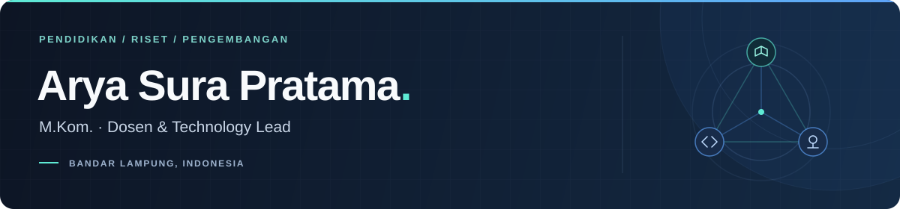

<picture>
  <source media="(max-width: 600px)" srcset="assets/profile-banner-mobile.svg" />
  
</picture>

  <a href="https://aryasurapratama.github.io/"><strong>Portofolio ↗</strong></a> &nbsp;·&nbsp;
  <a href="https://softklinik.my.id/"><strong>SoftKlinik ↗</strong></a> &nbsp;·&nbsp;
  <a href="https://scholar.google.com/citations?user=KmvcpXoAAAAJ&hl=id"><strong>Publikasi ↗</strong></a> &nbsp;·&nbsp;
  <a href="https://wa.me/6282232623434"><strong>Hubungi ↗</strong></a>

Dosen tetap di **Jinarakkhita Buddhist College of Lampung** dan **Founder & Technology Lead di SoftKlinik**. Saya mengajar Teknologi Informasi dan Komunikasi serta mengembangkan website, aplikasi, dan sistem digital untuk kebutuhan pendidikan dan organisasi.

## Bidang fokus

| Bidang | Ruang lingkup |
| :--- | :--- |
| **Pendidikan & riset** | Pengajaran TIK, literasi digital, dan AI untuk pembelajaran |
| **Sistem akademik** | Administrasi, kehadiran mahasiswa, platform belajar, dan jurnal |
| **Web & aplikasi** | Website, aplikasi manajemen, dan integrasi sistem |
| **Keamanan informasi** | Perlindungan informasi dan kajian kriptografi |

## Karya & ekosistem

- **[SoftKlinik](https://softklinik.my.id/)** — Pengembangan website, perangkat lunak, dan sistem digital sesuai kebutuhan pengguna.
- **[Portofolio](https://aryasurapratama.github.io/)** — Profil, pendidikan, penelitian, dan karya digital.

  
   
  Ekosistem tim SoftKlinik · Teknologi dipilih sesuai kebutuhan produk.

**Profil akademik:** [Google Scholar](https://scholar.google.com/citations?user=KmvcpXoAAAAJ&hl=id) · [SINTA](https://sinta.kemdiktisaintek.go.id/authors/profile/6854537) · [ORCID](https://orcid.org/0009-0006-5780-671X)

> Untuk diskusi akademik, kolaborasi riset, atau pengembangan produk, **[hubungi saya →](https://wa.me/6282232623434)**
